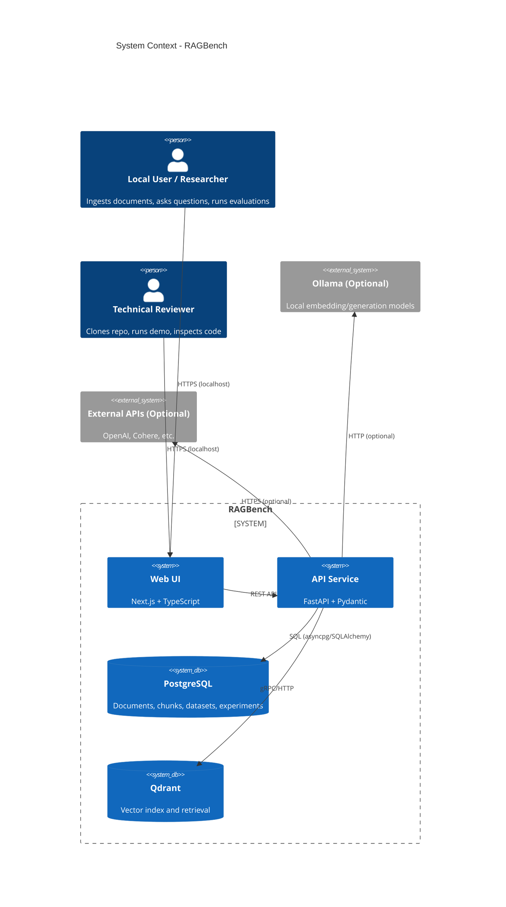
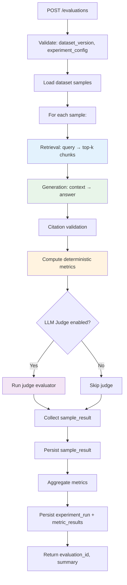
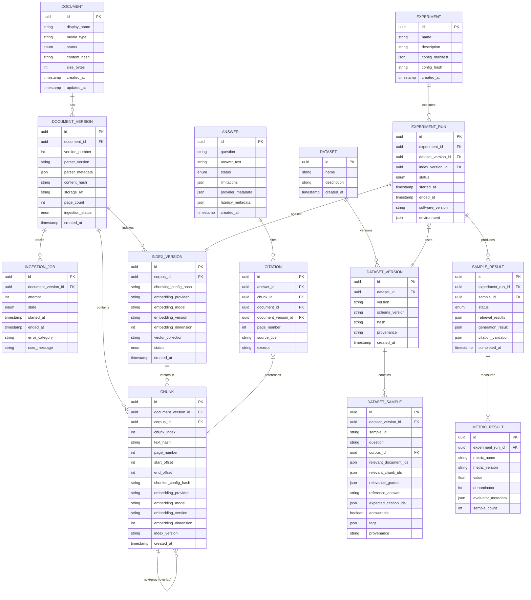
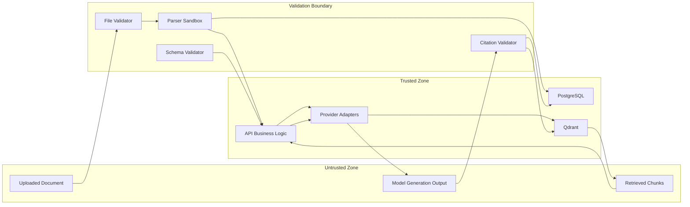

# RAGBench — System Architecture

**Version:** 1.0  
**Date:** 2026-10-22  
**Status:** Initialization baseline

---

## Architectural Principles

1. **Explicit Interfaces:** Every pipeline stage has a typed interface; implementations swappable.
2. **Provider Abstraction:** Embeddings and generation behind interfaces; Mock, local, external implementations.
3. **Data/Control Separation:** Retrieved content = untrusted data; never executed as instructions.
4. **Versioning by Default:** Documents, chunks, indexes, datasets, experiments all versioned.
5. **Local-First:** Docker Compose, loopback binding, no mandatory external services.
6. **Observability Built-In:** Correlation IDs, stage latency, structured logging.
7. **Security by Design:** Validation at boundaries; server-side citation resolution; no secrets in frontend.

---

## System Context Diagram



---

## Container Diagram

```mermaid
C4Container
    title Container Diagram - RAGBench

    Container(web, "Web Application", "Next.js, React, TypeScript", "Document library, chat, evaluation, experiments")
    Container(api, "API Service", "FastAPI, Python", "Orchestration, validation, provider abstraction")
    ContainerDb(pg, "PostgreSQL", "PostgreSQL 16", "Metadata, documents, chunks, datasets, experiments")
    ContainerDb(qdrant, "Qdrant", "Qdrant 1.10+", "Vector storage and similarity search")
    ContainerQueue(redis, "Redis (Optional)", "Redis 7", "Celery broker for background jobs")
    ContainerWorker(worker, "Worker (Optional)", "Celery, Python", "Long-running ingestion/evaluation")

    Rel(web, api, "JSON/REST", "API calls")
    Rel(api, pg, "Async SQL", "SQLAlchemy + asyncpg")
    Rel(api, qdrant, "gRPC/HTTP", "Qdrant client")
    Rel(api, redis, "Redis protocol", "Job queue (if enabled)")
    Rel(worker, pg, "Async SQL", "SQLAlchemy + asyncpg")
    Rel(worker, qdrant, "gRPC/HTTP", "Qdrant client")
    Rel(worker, redis, "Redis protocol", "Job consumption")
```

---

## Component Diagram (API Service)

```mermaid
C4Component
    title Component Diagram - API Service

    Component(routes, "API Routes", "FastAPI", "Request/response, validation, OpenAPI")
    Component(core, "Core", "Python", "Config, security, exceptions, middleware")
    Component(db, "Database", "SQLAlchemy", "Models, repositories, sessions")
    Component(ingestion, "Ingestion Service", "Python", "Upload, validation, parsing, status")
    Component(chunking, "Chunking Service", "Python", "Strategies, metadata, config hashing")
    Component(embeddings, "Embeddings Service", "Python", "Provider orchestrator, batching, validation")
    Component(vectorstore, "Vector Store", "Python", "Qdrant collections, upsert, query, delete")
    Component(retrieval, "Retrieval Service", "Python", "Scoped search, top-k, result mapping")
    Component(generation, "Generation Service", "Python", "Prompt builder, provider caller, response parser")
    Component(citations, "Citation Validator", "Python", "Resolve citations, validate against DB/Qdrant")
    Component(evaluation, "Evaluation Service", "Python", "Dataset runner, metrics, experiment orchestrator")
    Component(providers, "Providers", "Python", "Mock, Ollama, External implementations")
    Component(workers, "Workers (Optional)", "Celery", "Background ingestion/evaluation tasks")
    Component(observability, "Observability", "Python", "Logging, correlation IDs, metrics")

    Rel(routes, ingestion, "Delegates")
    Rel(routes, retrieval, "Delegates")
    Rel(routes, evaluation, "Delegates")
    Rel(ingestion, chunking, "Uses")
    Rel(ingestion, embeddings, "Uses")
    Rel(ingestion, vectorstore, "Uses")
    Rel(ingestion, db, "Persists")
    Rel(chunking, db, "Persists chunk metadata")
    Rel(embeddings, providers, "Calls")
    Rel(vectorstore, qdrant, "Client")
    Rel(retrieval, vectorstore, "Queries")
    Rel(retrieval, db, "Validates metadata")
    Rel(generation, providers, "Calls")
    Rel(generation, citations, "Validates")
    Rel(citations, db, "Resolves metadata")
    Rel(citations, vectorstore, "Resolves payload")
    Rel(evaluation, retrieval, "Runs retrieval")
    Rel(evaluation, generation, "Runs generation")
    Rel(evaluation, db, "Persists results")
    Rel(workers, ingestion, "Executes")
    Rel(workers, evaluation, "Executes")
```

---

## Data Flow: Document Ingestion

```mermaid
flowchart TD
    A[POST /documents] --> B[Validate: size, MIME, signature]
    B --> C[Generate document_id, version_id]
    C --> D[Store file safely with generated name]
    D --> E[Compute SHA-256 content_hash]
    E --> F[Parse: PDF/TXT/MD → text + page metadata]
    F --> G[Normalize text, preserve structure]
    G --> H[Chunk: fixed-size + overlap]
    H --> I[Generate chunk metadata + IDs]
    I --> J[EmbeddingProvider.embed(chunk_texts)]
    J --> K[Validate: dimension, finite values, length]
    K --> L[VectorStore.upsert(vectors, payload)]
    L --> M[Persist index_version record]
    M --> N[Update ingestion_job → ready]
    N --> O[Return document_id, version_id, status]
    
    style B fill:#fff3e0
    style F fill:#fff3e0
    style J fill:#e8f5e9
    style L fill:#e8f5e9
    style M fill:#e3f2fd
```

---

## Data Flow: Question Answering

```mermaid
flowchart TD
    A[POST /query] --> B[Validate: question, corpus_id, top_k]
    B --> C[EmbeddingProvider.embed([question])]
    C --> D[VectorStore.query(vector, top_k, corpus_filter)]
    D --> E[RetrievalResults: ranked chunks + metadata]
    E --> F[ContextBuilder: dedupe, budget, metadata]
    F --> G[PromptTemplate: question + context + instructions]
    G --> H[ChatGenerationProvider.generate(messages)]
    H --> I[Parse response → AnswerDraft]
    I --> J[CitationValidator: resolve each citation]
    J --> K{Citations valid?}
    K -->|Yes| L[Status: answered]
    K -->|No| M[Status: insufficient_evidence / failed]
    L --> N[Persist answer + citations]
    M --> N
    N --> O[Return AnswerResponse]
    
    style C fill:#e8f5e9
    style D fill:#e3f2fd
    style H fill:#e8f5e9
    style J fill:#ffebee
```

---

## Data Flow: Evaluation Experiment



---

## Data Model (ER Diagram)



---

## Trust Boundaries



**Rules:**
- Uploaded files never execute; parsed in sandboxed process if possible
- Retrieved chunks labeled "untrusted evidence" in prompt
- Model output parsed against strict schema; citations resolved server-side
- No model output directly rendered as HTML/JS
- Secrets never leave trusted zone (server-side only)

---

## Configuration and Versioning Strategy

| Artifact | Versioning Mechanism | Identity Components |
|----------|---------------------|---------------------|
| Document | Version number per upload | document_id + version_number |
| Chunk | Immutable per (doc_version, chunk_index, chunker_config) | UUIDv5(namespace, canonical_identity) |
| Index | New version on config change | corpus_id + chunking_hash + embedding_model + dimension |
| Dataset | Immutable versions; hash from canonical JSON | dataset_id + version + hash |
| Experiment | Immutable config manifest + hash | experiment_id + config_hash |
| Provider | Provider + model + version string | Recorded with every embedding/generation |

---

## Deployment Architecture (Local MVP)

```mermaid
flowchart TB
    subgraph HOST [Developer Machine]
        subgraph DOCKER [Docker Compose Network]
            WEB[Web:3000] --> API[API:8000]
            API --> PG[(PostgreSQL:5432)]
            API --> QDR[(Qdrant:6333)]
            API -.-> REDIS[(Redis:6379)]
            WORKER[Worker] -.-> REDIS
            WORKER -.-> PG
            WORKER -.-> QDR
        end
        
        OLLAMA[Ollama:11434\n(Native, Optional)]
        API -.-> OLLAMA
        WORKER -.-> OLLAMA
    end
    
    USER[Browser] --> WEB
    USER --> API
    
    style WEB fill:#e3f2fd
    style API fill:#e8f5e9
    style PG fill:#fff3e0
    style QDR fill:#fff3e0
    style REDIS fill:#fce4ec
    style WORKER fill:#fce4ec
    style OLLAMA fill:#f3e5f5
```

**Port Bindings (Loopback Only):**
- Web: `127.0.0.1:3000` → container `3000`
- API: `127.0.0.1:8000` → container `8000`
- PostgreSQL: Internal only (no host port)
- Qdrant: Internal only (no host port)
- Redis: Internal only (no host port)

---

## Technology Decisions Summary

| Decision | Choice | ADR |
|----------|--------|-----|
| Frontend Framework | Next.js 14+ (App Router), React 18, TypeScript 5 | ADR-001 |
| Backend Framework | FastAPI 0.110+, Pydantic 2, Python 3.11+ | ADR-001 |
| Metadata Database | PostgreSQL 16, SQLAlchemy 2.0, Alembic | ADR-001 |
| Vector Database | Qdrant 1.10+, gRPC client | ADR-002 |
| Embedding Provider | Interface + Mock/Ollama/External | ADR-003 |
| Generation Provider | Interface + Mock/Ollama/External | ADR-003 |
| Background Jobs | In-process MVP; Celery+Redis if justified | ADR-005 |
| Evaluation Metrics | Deterministic first; Ragas optional | ADR-004 |
| Containerization | Docker Compose, pinned images | ADR-001 |
| CI/CD | GitHub Actions | ADR-001 |
| Testing | pytest, Playwright | ADR-001 |

---

## Key Integration Points

| Integration | Protocol | Contract |
|-------------|----------|----------|
| Web → API | REST/JSON | OpenAPI 3.1 (generated from FastAPI) |
| API → PostgreSQL | asyncpg | SQLAlchemy 2.0 ORM |
| API → Qdrant | gRPC (preferred) / HTTP | Qdrant client 1.10+ |
| API → Ollama | HTTP | Ollama API (compatible with OpenAI schema) |
| API → External | HTTPS | Provider-specific SDK (wrapped) |
| Worker → API | Redis + Celery | Task signatures (if enabled) |

---

## Failure Modes and Handling

| Component | Failure Mode | Handling |
|-----------|--------------|----------|
| Parser | Timeout, crash, corrupted input | Catch → `failed` status; cleanup temp files; safe error |
| Embedding Provider | Timeout, rate limit, dimension mismatch | Bounded retry (3x, exponential backoff); circuit breaker; clear error |
| Qdrant | Unavailable, write error, dimension error | Health check gating; retry on transient; explicit error on dimension mismatch |
| Generation Provider | Timeout, rate limit, content policy, malformed JSON | Bounded retry; schema validation; fallback to `failed` status |
| Citation Validation | Hallucinated IDs, missing metadata | Reject invalid; adjust answer status; log for analysis |
| Database | Connection loss, migration failure | Startup health check; migration transaction; rollback on failure |
| Worker | Crash mid-job | Job status `failed`; idempotent retry on restart |

---

## Security Architecture Summary

- **Network:** All dev ports loopback; DB/vector ports internal
- **Secrets:** `.env` ignored; CI uses GitHub Secrets; no secrets in images
- **Upload:** Type/size/signature validation; generated storage names; parser limits
- **RAG:** Retrieved content = untrusted; prompt labeling; schema validation; citation resolution
- **Logging:** Structured JSON; correlation IDs; redaction; no PII/secrets
- **Deployment:** Public deployment blocked until auth/TLS/rate-limit implemented

---

## Open Architecture Decisions

| Decision | Status | Target Phase |
|----------|--------|--------------|
| Celery + Redis for background jobs | Pending ADR-005 | Phase 5/6 |
| Conversation history in MVP | Deferred | Phase 14 |
| Hybrid search / reranking | Deferred post-MVP | Phase 20+ |
| OpenTelemetry integration | Deferred | Phase 19 |
| Frontend state management (TanStack Query vs SWR) | Pending | Phase 13 |
| Ragas version compatibility | Pending verification | Phase 16 |